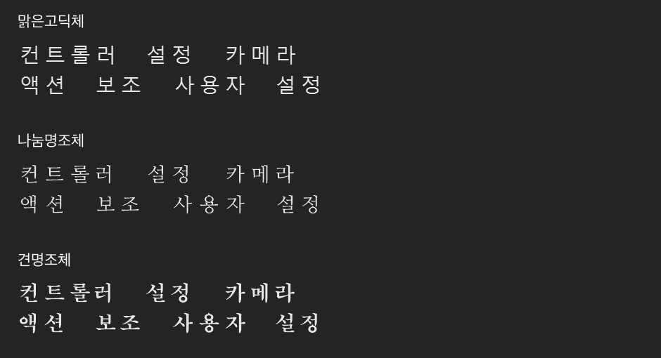

# 바이오하자드 5 한글 패치 (현재 Steam 버전용)

한국어 | [English](README.en.md)

현재 Steam 버전의 게임 파일에 한글 글꼴과 메시지를 적용합니다. 글꼴은 맑은고딕체·나눔명조체·견명조체 중 선택할 수 있으며, 기본값은 맑은고딕체입니다.

## 지원 환경

- Resident Evil 5 / Biohazard 5 Gold Edition, 현재 Steam 버전
- Windows(PowerShell 5.1 이상), macOS·Linux·Steam Deck(Python 3.10 이상)

## 설치

[최신 릴리스](https://github.com/eggu/resident-evil-5-korean-font-patch/releases/latest)의 **Assets**에서 ZIP을 받아 압축을 풀어 주세요.

1. **기존 한글 패치를 설치했다면 먼저 원본으로 되돌립니다.**
   Steam 라이브러리에서 게임을 오른쪽 클릭 → 속성 → 설치된 파일 → **게임 파일 무결성 확인**
2. 이 패치 폴더를 게임 폴더(`re5dx9.exe`가 있는 폴더) 안에 복사합니다.
   Steam에서 게임 오른쪽 클릭 → 관리 → 로컬 파일 보기로 게임 폴더를 열 수 있습니다.
3. 게임을 완전히 종료하고 운영체제에 맞는 파일을 실행합니다.
   - **Windows**: `Apply-Windows.bat`을 더블클릭
   - **macOS**: `Apply-macOS.command`를 더블클릭
   - **Linux / Steam Deck**: 터미널에서 `sh apply.sh`
4. 글꼴 선택 화면에서 `1` 맑은고딕체, `2` 나눔명조체, `3` 견명조체 중 하나를 고릅니다. Enter만 누르면 맑은고딕체를 사용합니다.
5. `Done.`이 나오면 끝입니다. 게임을 실행하면 한글로 나옵니다.

패치 폴더를 게임 폴더 밖에 두었다면, 실행 후 게임 폴더를 창에 끌어다 놓고 Enter를 누르세요.

## 글꼴 변경



게임을 완전히 종료하고 설치 파일을 다시 실행해 다른 글꼴을 고르면 됩니다. 번역 내용은 동일합니다.

터미널에서는 `sh apply.sh --font malgun "게임 폴더"`처럼 지정할 수 있습니다. 값은 `malgun`(맑은고딕), `nanum`(나눔명조), `kyeon`(견명조)입니다. Windows PowerShell에서는 `-Font malgun -GameFolder "게임 폴더"`를 사용합니다.

## 되돌리기

- **Windows**: `Restore-Windows.bat`을 더블클릭
- **macOS / Linux**: 터미널에서 `sh apply.sh --restore`
- 백업 파일이 없으면 Steam에서 **게임 파일 무결성 확인**을 실행하세요.

패치하기 전 원본은 같은 폴더에 `.orig` 파일로 보관됩니다.

## 알아둘 점

- Steam이 게임을 업데이트하거나 무결성 확인을 하면 패치가 풀립니다. 그때는 설치 3단계를 다시 실행하세요.
- macOS에서 처음 실행할 때 개발자 도구 설치 창이 뜨면 설치를 진행하세요(Python 3.10 이상이 필요합니다).
- 기존 한글 번역에 현재 버전의 액션 보조·카메라·분할 화면·개인정보 처리방침 관련 누락 문구를 추가했습니다. 다른 추가·변경 문구는 영어로 나오거나 맞지 않을 수 있습니다.

## 제작 및 출처

기존 한글 패치 제작진과 데이터 출처는 [CREDITS.md](CREDITS.md)를 참고하세요.

## 개발 및 빌드

Python 3.10 이상이 필요하며 추가 패키지는 필요하지 않습니다.

```sh
python3 tools/update_menu.py
python3 -m unittest discover -s tests
python3 tools/build.py --version 1.0.0
```

ZIP과 SHA256 파일은 `dist/`에 생성됩니다. 메뉴 번역은 `data/menu_ko.json`, 글자와 글꼴 칸의 대응은 `data/menu_charmap.json`에서 수정합니다. 기존 번역 메시지와 글꼴 데이터는 빌드 입력으로 포함되어 있습니다.

패처 코드는 MIT 라이선스이며, 기존 번역·글꼴 데이터의 권리는 별도입니다. [LICENSE](LICENSE)와 [CREDITS.md](CREDITS.md)를 참고하세요.
